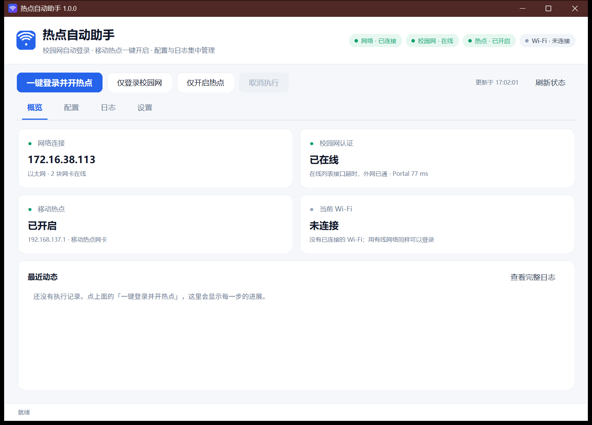
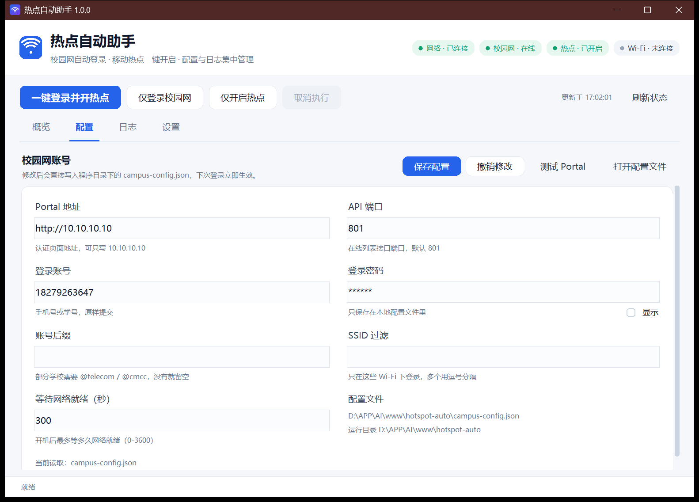
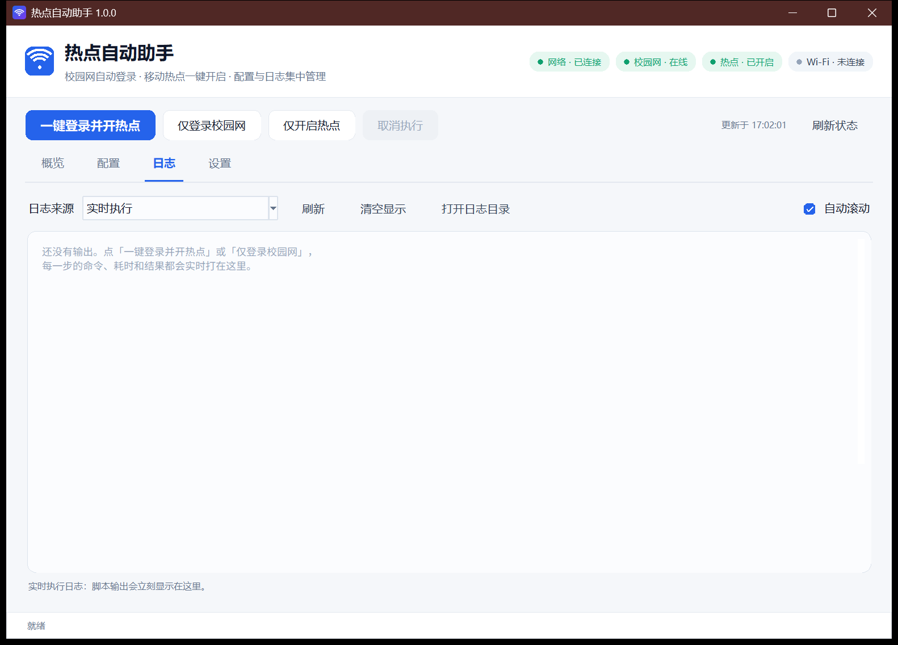
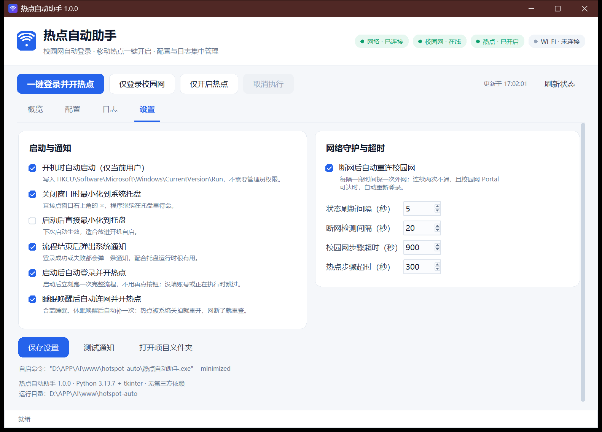

# 热点自动助手（桌面版）

把校园网自动登录和移动热点开成一个小窗口，不必再敲 PowerShell。现在是**一个 exe**：
双击就能用，不需要装 Python、不需要管理员权限、不往系统里注册计划任务。

登录和开热点的逻辑已经用 Python 重写进 `core\actions.py`，项目里原来那些 `.ps1` / `.vbs`
脚本已经删除，只剩这个程序。

## 界面预览

| 概览 | 配置 |
| --- | --- |
|  |  |

| 日志 | 设置 |
| --- | --- |
|  |  |

## 怎么用

1. 双击项目根目录的 **`热点自动助手.exe`**（第一次启动会在 exe 旁边生成
   `campus-config.json`、`settings.json` 和两个 `.log`）。
2. 打开「配置」页，确认 Portal 地址、API 端口、账号、密码，点 **保存配置**。
3. 回到「概览」页，点 **一键登录并开热点**。
   进度会实时滚到「日志」页，概览上的四个状态卡片也会自动刷新。
4. 关掉窗口默认是最小化到系统托盘（右下角图标，右键可显示或退出）。
   程序已在运行时再双击一次 exe，不会再开第二个窗口，而是把原来的窗口叫到前台。

想开机就自动连，见下面「开机就自动连」——不用再装计划任务。

## 运行要求

- Windows 10 / 11（64 位）
- 不需要 Python、不需要管理员权限、不需要装任何第三方库（已打包进 exe）

## 拷到别的电脑上用

`release\` 下有两份可以直接发出去的压缩包，解开就能用，目标机器不需要装 Python：

| 压缩包 | 里面是什么 | 适合 |
| --- | --- | --- |
| `热点自动助手-单文件版.zip` | 一个 exe + 使用说明.txt | 微信/网盘传给别人，最省事 |
| `热点自动助手-文件夹版.zip` | exe + `_internal\` + 使用说明.txt | 放 U 盘长期用，启动更快、不容易被杀毒拦 |

两个版本功能完全一样。第一次在新电脑上运行时它还没有账号，会提示并跳到「配置」页，
填一次账号密码就保存在 exe 旁边的 `campus-config.json` 里，之后换电脑只需重填这一次。

exe 没有代码签名，Windows 10/11 首次运行会弹 SmartScreen 的「Windows 已保护你的电脑」，
点「更多信息 → 仍要运行」即可；被 360/腾讯管家 拦的话选「允许程序运行」。

重新生成这两份压缩包：

```powershell
# 单文件版
python -m PyInstaller --noconfirm --clean --onefile --windowed --optimize 2 --name 热点自动助手 `
  --icon desktop\assets\app.ico --add-data "desktop\assets;assets" desktop\app.py
# 文件夹版
python -m PyInstaller --noconfirm --clean --onedir  --windowed --optimize 2 --name 热点自动助手 `
  --icon desktop\assets\app.ico --add-data "desktop\assets;assets" desktop\app.py
```

打好的 exe 放进 `release\热点自动助手-单文件版\` 和 `release\热点自动助手-文件夹版\`，
连同 `使用说明.txt` 一起用 `tar -a -c -f xxx.zip 文件夹名` 压成 zip 即可。

## 内存占用

| 状态 | 工作集（任务管理器「内存」） | 私有内存（提交量） |
| --- | --- | --- |
| 空 Python（参照） | 11 MB | 6 MB |
| 刚启动、窗口开着 | 15 MB | 22 MB |
| 收在托盘里空闲 1 分钟以上 | 8–10 MB | 22 MB |
| 正在跑一轮登录 + 开热点 | 20 MB 上下 | 22 MB |

私有内存是这个程序的"地板"：Tk 要加载 Tcl/Tk 运行库和字体，`tracemalloc` 里业务对象只有
0.4 MB，其余都在解释器和 Tk 的 C 侧。工作集（任务管理器里那一栏）则是可以还给系统的——
程序会在空闲时主动交回物理页，所以托盘常驻时实际只占十兆上下。

任务管理器「虚拟内存」一栏显示的 GB 级数字是 CPython 在 Windows 上的地址空间预留
（空跑一行 `python -c pass` 同样显示 4.2 GB），不是实际占用。

为了压到上面的数字，做了这几件事：

- HTTP 探测直接用 socket 发请求，不再 `import urllib.request` —— 它会连带拉起
  `http.client` / `email` / `ssl`，实测要 3.5 MB，是本程序最贵的一条 import；
- 读 Wi-Fi SSID 改用 WlanAPI（`wlanapi.dll`），不再每 5 秒起一个 `netsh` 子进程——原来光是
  这个进程的反复创建销毁，就让内存曲线一直在抖；
- 收在托盘里时不再刷新界面：Tk 每重绘一次就会把十来兆工作集重新占回来，隐藏时只记快照、
  只更新托盘提示，等你把窗口叫出来再一次性渲染；
- 空闲（90 秒无操作）或托盘常驻（每 60 秒）时调 `EmptyWorkingSet` 把物理页交回系统，
  私有内存不变，任务管理器里的占用会掉到个位数；
- 日志控件和内存缓冲都按行数裁剪（最多保留最近 1200 行），常驻一整天也不会慢慢涨；
- 界面建好后调一次 `gc.freeze()`，之后每轮回收只扫新产生的对象，不再反复扫启动期的控件；
- 断网看门狗就是一个线程加一个 `Event`，不轮询文件、不起子进程，等网络事件时才动。

实测：长时间运行句柄数稳定在 300 左右、线程数稳定在 9–12，内存只有预热期的一点点上浮，
不会线性增长。

## 界面说明

| 页签 | 作用 |
| --- | --- |
| 概览 | 四个状态卡片（网络连接 / 校园网认证 / 移动热点 / 当前 Wi-Fi）；最近动态（点右上角「查看完整日志」跳日志页）；一键操作按钮 |
| 配置 | 两列表单编辑 `campus-config.json`，保存/撤销/测试 Portal 在主按钮区；密码框下方的开关可临时显示明文 |
| 日志 | 实时执行输出（含写进 `campus.log` / `hotspot.log` 的进度），或翻看历史日志；没跑过时会显示一段提示 |
| 设置 | 左栏「启动与通知」，右栏「网络守护与超时」：开机自启、启动后自动登录、睡眠唤醒后自动连网并开热点、托盘、通知、断网重连、刷新/检测间隔、步骤超时 |

操作栏上的其他按钮：

- **仅登录校园网**：只跑登录这一步，不碰热点。
- **仅开启热点**：只开热点（前提是电脑已经有网络）。
- **取消执行**：立刻中止当前步骤（会杀掉正在跑的子进程）。空闲时是灰色不可点的。
- **刷新状态**：立刻重新探测一次（不用等轮询间隔）。

键盘也能操作：`Tab` 在按钮之间移动，`Enter` 或空格触发，聚焦时按钮外圈会亮一圈蓝线。
窗口高度小于内容时，配置页和设置页会出现一条细滚动条（也可以直接滚轮），
按钮不会被挤出可视区。

界面没有一个第三方 UI 库：圆角卡片、圆角按钮、状态药丸、细滚动条都是 `desktop\ui.py`
里用 Canvas 画的（十几个控件而已），好处是 DPI 100%/150% 下不走样、打包产物也不会变大多少。
配色走的是「浅灰底 + 白卡片 + 一个蓝色主色」，正常/警告/错误三种状态分别用绿/琥珀/红，
文字和底色的对比度都在 4.5:1 以上，缩放到 150% 也仍然清楚。

## 开机就自动连

「设置」页勾上这两个开关就行：

1. **开机时自动启动（仅当前用户）** —— 写 `HKCU\...\Run` 启动项，开机后程序自己在托盘里起来；
2. **启动后自动登录并开热点** —— 程序一启动就先跑一次完整流程（登录校园网 + 开热点），不用再点按钮。

两个都勾上，效果就是：开机 → 托盘里默默连着网 → 连好后弹一条「已自动登录校园网并开启热点」的通知。
启动时如果还没填账号密码、或者已经有一个流程在跑，它会安静跳过，不弹窗打扰。

## 断网自动重连

校园网掉线之后（熄灯断网、跨天被踢、中途会话失效），不用自己盯着屏幕：只要程序还开着
（窗口最小化在托盘里也算），它会替你守着，网断了就自动把网接回去。

判断和动作：

- 每隔 **断网检测间隔**（默认 20 秒）探一次外网，用的是 `generate_204` 端点，只看"这台机器
  到底能不能上网"，不看在线列表接口的脸色。
- **连续两次**探不通才算断网，避免一次网络抖动就误拨号。
- 断网时先确认校园网 Portal 可达，再跑一次登录；Portal 不可达（说明不在校园网，
  比如连了家里的 Wi-Fi）只写一行日志，然后安静两分钟，不会拿账号去乱试。
- 重试有退避：第 1 次失败后隔 2 分钟，第 2 次 4 分钟，之后最长 10 分钟一次；网络恢复正常
  后自动归零，下次断网又是秒级响应。
- 重连过程不走前台：不抢你正在看的页签，只在「日志」页留痕，结束后弹一条系统通知。

开关和参数都在「设置」页：取消勾选 **断网后自动重连校园网** 即可关闭，**断网检测间隔** 可调
（10–300 秒）。注意它只在程序运行时生效——想让机器一直有人守着，把「开机时自动启动」也勾上。

## 合盖 / 睡眠回来之后

笔记本合盖睡眠、或者休眠再唤醒，网卡通常会重新连一次，旧连接全断。程序对这种情况做了专门处理：

- 唤醒后事件循环会出现一段空档（超过 90 秒），程序据此判定"刚从睡眠里回来"，主动清掉
  SSID 缓存和在线状态缓存，立刻重新探测一次，而不是等下一个 5 秒周期慢慢发现。
- 状态栏会短暂显示「已从睡眠恢复，正在刷新状态…」，日志里留一行「程序从睡眠中恢复（间隔
  N 分钟），正在重新检测状态。」。
- 万一探测线程卡在某个系统调用里出不来了（网络栈唤醒慢时会这样），程序发现"超过 60 秒没
  新结果"就自己把探测线程换掉，不需要你重启。
- 睡眠这段空档不会被当成"连续两次探测失败"，所以睡醒不会莫名其妙触发一次自动重连；
  真的断网了它还是照常重连。
- 从托盘还原窗口时，睡眠期间攒下的最新状态会立刻补上，不用再手动点「刷新状态」。
- **唤醒后会补一次连接**：系统睡眠/休眠时通常会把移动热点关掉，唤醒后程序会自己把它开回来；
  如果这时校园网也断了，就先重新登录再开热点。两样都正常就只留一行「网络和热点都在，无需操作」，
  不打扰你；补的步骤也只跑需要的那些，不做无谓的拨号。

这几个行为由「设置」页的 **睡眠唤醒后自动连网并开热点** 控制（默认开启）。关掉之后，唤醒只会刷新
状态，不再自动开热点。

## 文件结构

运行所需的全部东西（都在 exe 旁边生成）：

```
热点自动助手.exe     主程序，单文件，10.8 MB
campus-config.json  校园网账号与 Portal 地址（首次启动自动生成）
settings.json       本程序的偏好（首次启动自动生成）
campus.log          登录日志
hotspot.log         热点日志
```

源码（想改才需要看）：

```
desktop\
  app.py            主程序（界面装配、状态轮询、事件泵、单实例、看门狗）
  ui.py             设计令牌 + 自绘控件（圆角按钮/状态药丸/圆角卡片/细滚动条）
  core\actions.py   登录校园网、开热点（原生 Python 实现，含内联 WinRT 调用）
  core\config.py    读写 campus-config.json / settings.json，打包后路径与配置迁移
  core\probe.py     网卡/热点/Wi-Fi/Portal/在线列表探测（标准库 + 裸 socket）
  core\runner.py    步骤执行器（事件流、超时、取消、写日志文件）
  core\logfile.py   按旧格式追加日志
  core\notify.py    WinRT 通知（失败回退托盘气泡）
  core\autostart.py 开机自启注册表读写（exe 模式下直接指向 exe）
  core\tray.py      系统托盘图标与右键菜单（ctypes 调 Win32）
  assets\app.ico    程序与托盘图标，make_icon.py 可重新生成
  screenshots\      界面截图，README 里引用
  README.md         本文件
build\
  热点自动助手.spec  PyInstaller 打包配置
  dist\             单文件版产物
  dist-dir\         文件夹版产物
release\
  热点自动助手-单文件版\ + .zip   发给他人的单文件包
  热点自动助手-文件夹版\ + .zip   发给他人的文件夹包
```

源码调试：`python desktop\app.py`（带控制台）或 `desktop\调试启动.bat`。

重新打包（在 `desktop` 目录下执行，路径要写绝对路径）：

```
python -m PyInstaller --noconfirm --clean --onefile --windowed --optimize 2 --name 热点自动助手 ^
  --icon "D:\APP\AI\www\hotspot-auto\desktop\assets\app.ico" ^
  --add-data "D:\APP\AI\www\hotspot-auto\desktop\assets;assets" ^
  --distpath "D:\APP\AI\www\hotspot-auto\build\dist" ^
  --workpath "D:\APP\AI\www\hotspot-auto\build\work" ^
  --specpath "D:\APP\AI\www\hotspot-auto\build" ^
  "D:\APP\AI\www\hotspot-auto\desktop\app.py"
```

`--optimize 2` 会去掉 docstring 和 assert，产物能小 0.3 MB 左右，对运行没有影响。
打包完把 `build\dist\热点自动助手.exe` 复制到项目根目录就是新版本。

## 常见问题

**双击没反应**
先看右下角托盘里有没有图标——关窗口默认是最小化到托盘，不是退出。
如果托盘里也没有，用任务管理器看有没有 `热点自动助手.exe` 残留进程，结束掉再启动。

**杀毒软件报毒**
PyInstaller 打包的单文件程序常被启发式引擎误报，加个信任即可。介意的话可以改用源码方式运行
（`python desktop\app.py`），行为完全一样。

**提示 Portal 不可达，但流程还是"完成"**
这是有意的：不在校园网里（比如连了家里的 Wi-Fi）也算正常结束，只是不登录。
以概览页的在线状态和日志内容为准。

**热点开不起来**
先在 Windows 设置 → 网络和 Internet → 移动热点 里手动试一次。开热点用的是系统的
`NetworkOperatorTetheringManager`，需要无线网卡；部分网卡驱动会把功能阉割掉。

**状态卡片显示"未在线"但网络是通的**
在线的判断依据是认证接口返回的在线列表里有没有本机 IP。校园网不同网段、认证接口换了端口，
都会导致查不到。所以程序会再探一次 `generate_204`：只要这台机器真能上网，就显示**已在线**，
而不是照着列表说"未在线"。

**卡片写着"在线列表没列出本机，外网已通"**
这个接口的列表会抽风：实测出现过列表返回 `total=0`、但这台机器照样能上网的情况。
程序以"能不能上网"为准，所以仍然算已在线，只是把列表的异常情况写出来提醒你。

**"校园网认证"卡片偶尔变成"无法查询 / 接口超时"**
校园 Portal 的 `/eportal/portal/online_list` 接口本身就不稳定：实测会间歇性收下请求却不回包
（同一个接口连发几次，约一半会卡到超时，ping 却一直是 0 丢包）。程序每次探测会重试 2 次，
仍然失败时不会把卡片打回"未在线"：先继续显示最近一次成功查到的结果（标注"多少秒前"，
最多保留 5 分钟），同时用 204 探测判断这台机器到底能不能上网——能上网就显示
**已在线 · 在线列表接口超时，外网已通**。

**托盘图标不见了**
Windows 会把不常用的托盘图标折叠进「^」里；也可以在任务管理器里结束 `热点自动助手.exe` 重新启动。

## 从旧版本迁移

之前那套 PowerShell 脚本（`campus-login.ps1`、`enable-hotspot.ps1`、`silent-run.ps1`、
`launcher.vbs`、`setup.ps1` 等）已经全部删除，计划任务 `HotspotLogin` 也已注销。

- 账号还在：首次运行 exe 时会从项目根目录（或 `desktop\`）把 `campus-config.json` 复制过来，
  不用重填；只有在新机器上才需要手动填一次。
- 旧日志没删：`campus.log` / `hotspot.log` 继续沿用，`launcher.log` 是旧流程留下的，可以删掉。
- 原来计划任务负责的"开机自动连"，现在由「设置」里的两个开关接管。

登录这一步的判断逻辑和旧脚本保持一致，包括那个容易误报的地方：

- 在线列表查不到本机时，会再用 `generate_204` 探一次外网，能上网就判定已在线，日志里写
  「在线列表接口不可用，但外网已通，判定为已在线，无需登录。」——不会再因为接口抽风报"登录失败"。
- 拨号后同样的三态判断，失败自动重试 3 次（每次间隔 5 秒）。

## 开发笔记

- 图标由 `python desktop\assets\make_icon.py` 重新生成（纯标准库画 PNG/ICO，不依赖 Pillow）。
- 界面按系统 DPI 缩放：`apply_dpi_awareness()` 读出 DPI，所有尺寸都过 `self.s(px)`。
- 直接 `python desktop\app.py` 就能带控制台调试；加 `--minimized` 可模拟开机自启时"只留托盘"。
- 想加一步操作，就在 `app.py` 里拼一个 `runner.Step(label=..., func=..., timeout=...)`，
  `func(ctx)` 返回 True/False，`ctx.log("...")` 的每一行都会实时滚进日志页并写进日志文件。
- 打包后路径都在 exe 旁边：`config.PROJECT_DIR` 会自动指向 exe 所在目录，
  资源文件从 `sys._MEIPASS` 读。
